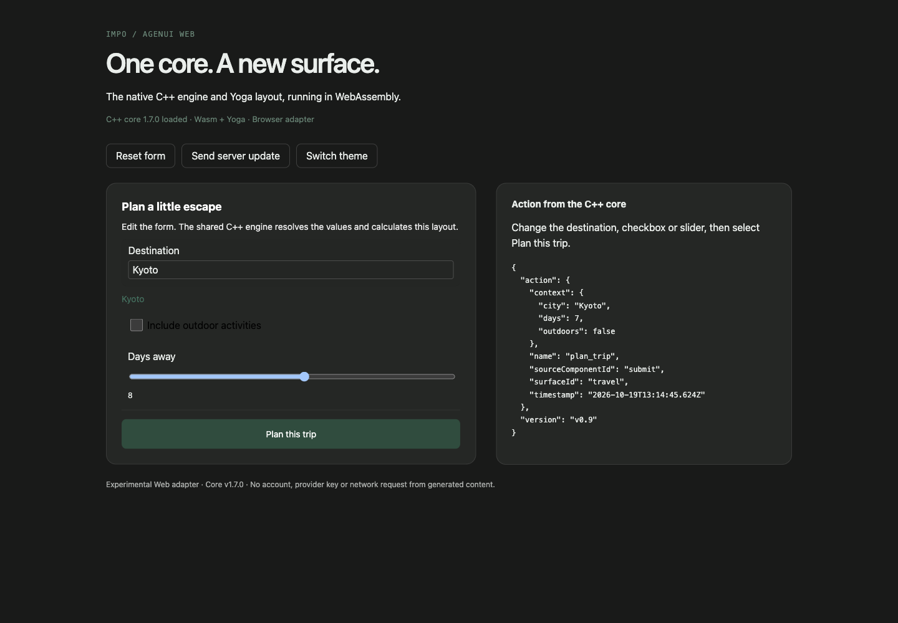
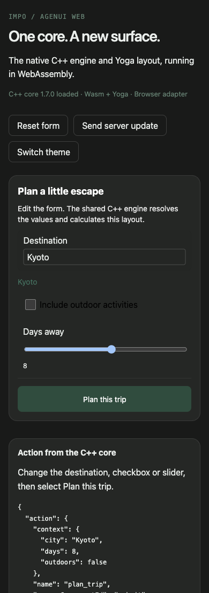

# Web port validation — 2026-10-19

Source baseline: AGenUI 1.7.0, upstream
`5c347a8352c1afff31879bcf5af4101df4f94137`.

## Passed

- Emscripten 6.0.12 Release build of the shared C++ core, Yoga 2.0.0 and Web
  bridge on macOS arm64. The `.wasm` binary is 1,155,408 bytes; the ES module
  loader is 146,646 bytes. The initial npm archive is approximately 411 KB.
- All 12 Web logic tests against the real Wasm module. These cover binding,
  button context, fragmented Unicode input, server data updates, Yoga width
  changes, session isolation, component/surface removal, disposal, API limits,
  null diffs, callback failures, custom measurements and theme updates.
- TypeScript declaration checks, JavaScript syntax checks, `git diff --check`,
  and npm package contents including licenses and the Wasm asset.
- Manual Chromium check in CCTools Test Browser: edited text reflected in the
  bound label; checkbox editing; keyboard slider change; resolved button event;
  server update; light/dark styles; and 1440/390 CSS-pixel layouts. After resize
  settled, the 390-pixel viewport and document were both 390 pixels wide.
  The last action contained `city: Kyoto`, `days: 8`, `outdoors: false`.
  Screenshots below are viewport captures of the local example, without an
  account or private data. Background-tab timer throttling can delay updates.

## Upstream native baseline failures

The native C++ suite builds on macOS. CTest reports **19 failures out of 1,131
registered tests**, plus two disabled tests. Rebuilding and rerunning with the
unmodified upstream logger source produces the **identical 19 failure names**:

- 15 `ImageMeasureTest` cases (Harmony-specific measurement expectations).
- `EventDispatcherBlackBoxTest.ED005_UpdateComponents_ListenersReceiveAdd`.
- `StreamRealisticIntegrationTest.SRI004_StreamingTextDM_TinyChunks`.
- `StreamRealisticIntegrationTest.SRI006_StreamingMarkdownDM_TinyChunks`.
- `QueuePressureTest.QP004_ProducerVsDestroy_GracefulShutdown` (segmentation fault).

These failures are not represented as passing checks. No attempt was made to
change upstream native behavior while adding this platform. The explicit
`<cstdarg>` include was restored after the baseline comparison, and the native
suite rebuilt successfully. The Web scheduler uses no native worker threads.

## Not established

Safari, Firefox, physical mobile browsers, packaged Electron and physical
native-device behavior were not checked. This is an experimental platform port,
not a production acceptance result or full native component parity. Impo's
production clients still use their existing renderers.
